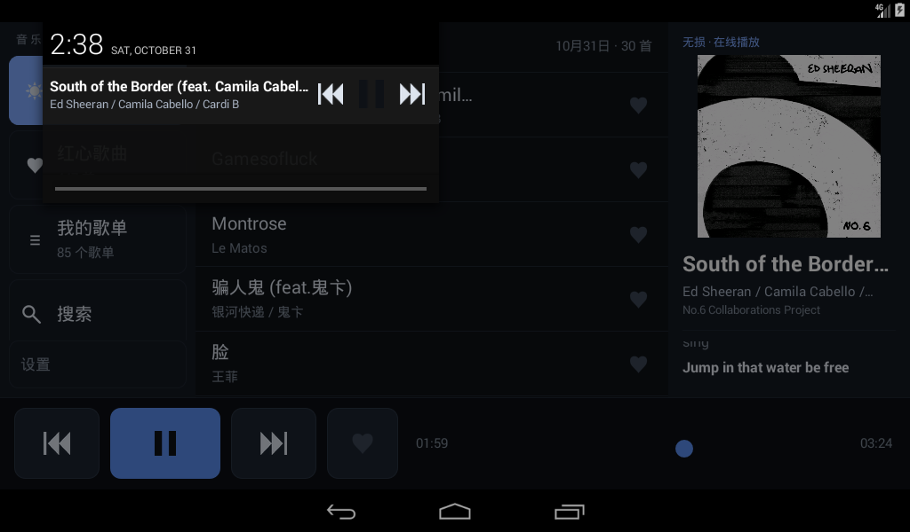

# Netodia Car · 网易云音乐车机播放器

给老车机用的网易云音乐客户端。目标很具体：**Android 4.4.2（API 19）、32 位 ARM、横屏、1GB 内存**
这类原厂车机能跑得动、看得清、点得着，而且能把会员音质用上。

车机端是纯 `android.*` 原生实现（零第三方库、APK 约 120KB），
服务端是一个 Node 进程，把网易云的加密、风控、失效 URL 全部挡在车外，对车机只暴露几个稳定的 JSON 接口。


## 功能

- 每日推荐、红心歌曲、我的歌单、搜索（登录态由服务端持有，车机不接触账号凭据）
- 播放：上一首/下一首、进度拖动、歌词、封面、播放队列自动续播
- **后台播放**：前台服务 + 通知栏控制，切到导航 App 音乐不断
- **音频焦点**：导航播报/来电时自动暂停，结束后续播；允许压低时降到 20% 音量
- **音质可选**：标准 128K / 高 192K / 极高 320K / 无损 FLAC / Hi-Res / 超清母带（会员档位实测可用）
- 边播边缓存（服务端 L2 缓存 + 车机本地缓存），WiFi 下自动预取下一首
- 开机自启；左舵布局（播放控制集中在左下，不用跨屏精确触摸）

| 通知栏控制 | 音质选择 |
|---|---|
|  |  |

## 架构

```
车机 APK (Android 4.4)  ──HTTP──>  自建服务端 (Node)  ──>  网易云 API
        │                              │
        └─ 本地音频缓存                 └─ L2 音频缓存 + cookie/匿名设备身份
```

车机端只认自定义接口：`/api/recommend/songs`、`/api/likelist`、`/api/user/playlists`、
`/api/stream`、`/api/lyric`、`/api/search` 等。协议变化、风控、URL 过期都在服务端吸收。

详见 [docs/ARCHITECTURE.md](docs/ARCHITECTURE.md)。

## 服务端部署

需要 Node 18+（容器里用的是 20）。

```bash
git clone https://github.com/nak1li/netodia-car.git
cd netodia-car
npm --prefix server install        # 装网易云 API 实现层
```

准备两样东西：

1. **网易云登录 cookie**：跑 `python3 server/ncm_login.py qr` 出二维码，用手机网易云 App 扫码，
   服务端在登录回调里把 cookie 写到 `~/.ncm/secrets/ncm.cookie`（600）。
   脚本本身只负责出码与轮询，不写 cookie。
2. **访问令牌**：`head -c 24 /dev/urandom | base64 > ~/.ncm/secrets/ncm.token && chmod 600 ~/.ncm/secrets/ncm.token`
   车机端每条请求都要带这个 token（`X-NCM-Token` 头或 `?token=`），避免接口被白嫖。

启动：

```bash
NCM_PORT=28475 \
NC_COOKIE_FILE=~/.ncm/secrets/ncm.cookie \
NCM_TOKEN=$(cat ~/.ncm/secrets/ncm.token) \
NCM_CACHE_DIR=~/.ncm-cache/audio \
node server/server.js
```

或者用 Docker：

```bash
docker build -t netodia-car .
docker run -d --name ncm-server -p 28475:28475 \
  -v ~/.ncm/secrets:/secrets:ro -v ~/.ncm-cache:/cache \
  -e NCM_TOKEN=$(cat ~/.ncm/secrets/ncm.token) netodia-car
```

容器内路径约定：`/app/server` 是代码，`/app/cache` 是音频与元数据缓存（挂 `~/.ncm-cache`），
`/secrets` 是 cookie 与 token（挂 `~/.ncm/secrets`，只读）。

登录后第一次建议先在容器里注册一次匿名设备身份（缺了它，登录类请求会被网易云判成「异常设备」）：

```bash
docker exec ncm-server node /app/server/anonimous.js
```

自测：`node server/test_cache.js`（缓存并发/续传的 19 项断言）。

## 车机端构建

需要 JDK 11 + Android SDK（build-tools 34、platforms/android-19）。不用 gradle，
`app/build.sh` 直接跑 aapt2 → javac → d8 → zipalign → apksigner。

```bash
export NCM_TOKEN_FILE=~/.ncm/secrets/ncm.token     # 服务端令牌，构建时注入
export NCM_SERVER=http://<你的服务器IP>:28475     # 或写进 ~/.hermes/secrets/ncm.server
bash app/build.sh
# 产物 app/build/Netodia-Car.apk
```

令牌和服务器地址都是**构建时生成** `Secrets.java` 注入的，源码里不留凭据。
签名密钥在 `app/keys/release.keystore`（首次构建自动生成，已被 .gitignore 排除，请自己保管）。

安装到车机：`adb install -r app/build/Netodia-Car.apk`。
车上没有 adb 也可以把 APK 放 U 盘，用文件管理器装。

首次启动如果连不上服务端，进「设置」填服务器地址和令牌即可。

## 已知限制

- 只针对 API 19 优化，界面按 1024×600 / mdpi 调过；其他分辨率能用但右栏会被挤压
- 播放队列不做持久化：进程被杀后重启服务不会自动续播
- 未实现 MediaSession（API 21+），通知栏是 RemoteViews 按钮，个别深度定制车机可能不显示按钮
- 服务端 cookie 过期需要重新扫码（无自动刷新）

## 引用了哪些项目

本项目**没有复制**任何第三方源码，服务端依赖两个 npm 包，都在上游仓库里改：

| 项目 | 仓库 | 许可 | 用途 |
|---|---|---|---|
| [@neteasecloudmusicapienhanced/api](https://github.com/NeteaseCloudMusicApiEnhanced/api-enhanced) | NeteaseCloudMusicApiEnhanced/api-enhanced | MIT | **主力实现层**（v4.41.1）：封装网易云各接口、签名与风控 |
| [NeteaseCloudMusicApi](https://github.com/Binaryify/NeteaseCloudMusicApi) | Binaryify/NeteaseCloudMusicApi | MIT | **兜底实现层**（v4.32）：enhanced 装不上时自动回退，服务不至于起不来 |

车机端（`app/`）**零第三方库**，只用 Android framework 与 `org.json`，所以 APK 里没有任何第三方代码。

### 本地补丁

legacy 实现层需要一处补丁：非 login 接口不再替换 `NMTID`
（NMTID 与登录态绑定，被换掉后网易云会把带有效 `MUSIC_U` 的请求当成「另一台设备」，`account` 恒为 null）。

补丁由 `server/tools/patch_netease_api.js` 在 `npm install` 后自动执行（幂等，可重复跑）。
打补丁的文件是 `node_modules` 里的，不随本仓库分发。

```bash
npm --prefix server install     # 会自动打补丁
```

## 致谢 / 引用

本项目没有复制任何第三方源码。服务端依赖两个上游仓库（均 MIT）：

- [@neteasecloudmusicapienhanced/api](https://github.com/NeteaseCloudMusicApiEnhanced/api-enhanced) — 主力实现层（v4.41.1）
- [NeteaseCloudMusicApi](https://github.com/Binaryify/NeteaseCloudMusicApi) — 兜底实现层（v4.32）

legacy 层需要一处本地补丁（非 login 接口不替换 NMTID），由
`server/tools/patch_netease_api.js` 在 `npm install` 后自动执行，幂等。

车机端（`app/`）零第三方库，只用 Android framework 与 `org.json`。

## 贡献

Issue / PR 都欢迎。改车机端请守住两条底线：

1. 不要引入第三方库——老车机的 dalvik + 1GB 内存扛不住，这也是 APK 只有 120KB 的原因
2. 不要用 API 19 以上才有的接口（`java.util.Base64`、stream、`setElevation`、VectorDrawable 等）

## License

PolyForm Noncommercial License 1.0.0 —— 仅限非商业用途。
