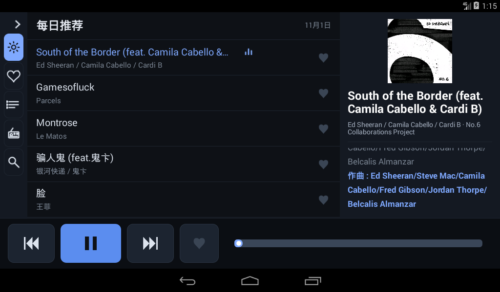
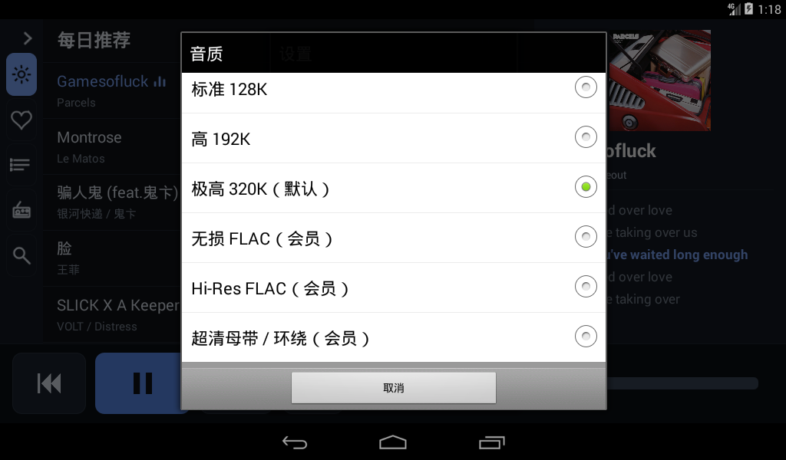

# Netodia Car · 网易云音乐车机播放器

> 给**老车机**用的网易云音乐客户端。目标很具体：Android 4.4.2（API 19）、32 位 ARM、
> 1GB 内存的原生车机能跑得动、看得清、点得着，而且**能用上会员音质**。

现代车机 App 大多要求 Android 8+，老车机装不上也跑不动；即使勉强装上，
界面密度、内存占用、字体渲染也都不适配。这套东西就是为那类机器重写的。

车机端是**纯 `android.*` 原生实现**（零第三方库，APK 约 195KB），
服务端是一个 Node 进程，把网易云的加密、风控、失效 URL 全部挡在车外，
对车机只暴露几个稳定的 JSON 接口。

| 播放界面 | 音质选择 |
|---|---|
|  |  |

左栏 5 个入口，收起时只留图标（[展开态见这里](docs/screenshots/nav.png)）。

---

## 为什么值得看一眼

**老车机的现实困境**：厂商 ROM 停在 Android 4.4/6.0，内存 1GB，屏幕 1024×600，
官方 App 的最低要求直接把它们排除在生态之外。这类机器不是不能装 App，
而是**装什么都卡、什么都点不准、什么都看不清**。

这个项目的取舍全部围绕这一点：

- **APK 只有 195KB**，零第三方依赖，连图片都是脚本生成的位图（Android 4.4 字体缺字形，
  `⏮⏸⏭`/`⌕`/`☀` 这些字符在 4.4 上是空白或被裁切的残片，图标必须自己画）。
- **界面按 1024×600 mdpi 重新设计**，不是缩放手机 App：
  左舵布局把播放控制集中在左下角（右手不必跨屏精确触摸），列表行高 72dp，
  字号只用 24/20/16/15/13 五档，次要文字对比度全部 ≥4.5:1。
- **所有协议复杂度搬到服务端**。车机不可物理到达，改一次代码就要人跑一趟，
  所以接口演进、网易云风控、URL 过期全部由服务端吸收，车机端只保留「播放 + 缓存 + UI」。

---

## 核心功能

| 功能 | 说明 |
|---|---|
| 每日推荐 | 每天 6:00 更新的推荐流 |
| 心动模式 | 以当前播放的歌为种子，滚雪球式连播相似歌曲 |
| 我的歌单 | 账号下的歌单列表，点进去直接播 |
| 私人 FM | 无限流随机推荐，**播完自动续下一批**，不用手动点 |
| 搜索 | 歌曲 / 歌单 / 歌手 |
| 播放控制 | 上一首 / 下一首 / 进度拖动 / 封面 / 滚动歌词 |
| 红心 | 列表内红心 + 底栏红心，与服务端状态双向同步 |
| 音质 | 标准 128K / 高 192K / 极高 320K / 无损 FLAC / Hi-Res / 超清母带（会员档位实测可用） |
| 缓存 | 服务端 L2 缓存 + 车机本地 L1 缓存，WiFi 下自动预取下一首 |
| 开机自启 | 开机自动拉起并恢复播放 |
| 后台播放 | 切到导航 App 音乐不断 |

## 特色功能

这些是花时间踩坑换来的，不是通用播放器都有的：

**1. 音频焦点处理（导航播报不打架）**
车载导航每隔几十秒就播一次路名，如果处理不好就是「音乐被导航顶掉，再也回不来」。
这里区分了**用户手动暂停**和**被焦点打断**两种状态：导航播报结束只会恢复被打断的那次播放，
不会把你自己按暂停的歌重新放出来（这个 bug 以前必现）。
允许压低（CAN_DUCK）时降到 20% 音量而不是直接停。

**2. 流式播放的时长兜底**
车机走 CDN 流式播放，上游常常不带 `Content-Length`，`MediaPlayer.getDuration()` 返回 0，
进度条会永远是空的、拖动也没意义。这里用接口返回的歌曲时长兜底，进度条才真正可用。

**3. 列表跟随当前播放滚动（锚点式）**
切歌时列表**跟着歌一行一行地走，当前行始终停在它原来的屏幕行位**——
既不强制居中（那样每次切歌都大跳，第一页尤其突兀），也不跳到看不见的地方。
用户自己拖过列表时锚点跟着走，不硬拽回来。

**4. 私人 FM 播完自动续批**
官方 `personal_fm` 一次只回 3 首且会重复。这里连要多批、按 id 去重凑够一批，
播放队列走完时由播放器回调驱动自动拉下一批并追加到列表末尾——
中途不打断、不闪断音。

**5. 心动模式（官方接口已死，用相似推荐替代）**
网易云的官方心动模式接口对本账号所有歌单一律返回 `400 不支持该歌单类型`，
换参数组合结果相同。改用 `/api/similar` 滚雪球：以当前歌为种子，
每轮拿上一批最后一首当新种子，最多 4 轮，去重后凑 30 首。

**6. 服务端缓存的正确性（坏音频会永久污染缓存）**
音频缓存的键是 `songId.quality.ext`；`.part` 临时文件**必须每请求唯一且隐藏命名**，
否则两路并发写同一个文件，rename 之后就是一首永远损坏的歌，
而且以后每次命中这个坏缓存都放不出来。只有 `written === Content-Length` 才允许提交落盘。

**7. 抗运营商 DPI**
车机走 4G 时运营商会对明文响应做 DPI：响应体里含网易云 CDN 域名就整包丢弃。
表现是「服务端日志写着已发 7807 字节，车机一个字节都没收到」。
解法是响应声明了 `Accept-Encoding: gzip` 时把 body 压一遍，客户端零改动。

**8. 零第三方库 + 免 Gradle 构建**
车机端只用 Android framework 与 `org.json`。构建脚本直接跑
aapt2 → javac → d8 → zipalign → apksigner，一条命令出包，不依赖 gradle 和网络。

**9. 凭据不上车机**
网易云 cookie 只在服务端。车机 APK 里不嵌任何账号信息，源码里也没有任何凭据——
服务器地址、令牌、公网 IP 全部**构建时注入** `Secrets.java`，`.gitignore` 排除。

---

## 架构

```
车机 APK (Android 4.4)  ──HTTP──>  自建服务端 (Node)  ──>  网易云 API
        │                              │
        └─ 本地缓存 L1                 └─ L2 音频缓存 + cookie/匿名设备身份
```

车机端只认自定义接口：`/api/recommend/songs`、`/api/likelist/songs`、
`/api/user/playlists`、`/api/stream`、`/api/lyric`、`/api/search`、`/api/fm`、
`/api/similar` 等。协议变化、风控、URL 过期都在服务端吸收。

详见 [docs/ARCHITECTURE.md](docs/ARCHITECTURE.md)。

---

## 服务端部署

需要 Node 18+（容器里用的是 20）。

```bash
git clone https://github.com/nak1li/netodia-car.git
cd netodia-car
npm --prefix server install        # 装网易云 API 实现层
```

准备两样东西：

1. **网易云登录 cookie**：跑 `python3 server/ncm_login.py qr` 出二维码，用手机网易云 App 扫码，
   服务端在登录回调里把 cookie 写到 `~/.ncm/secrets/ncm.cookie`（600）。
2. **访问令牌**：`head -c 24 /dev/urandom | base64 > ~/.ncm/secrets/ncm.token && chmod 600 ~/.ncm/secrets/ncm.token`
   车机端每条请求都要带这个 token（`X-NCM-Token` 头或 `?token=`），避免接口被白嫖。

启动：

```bash
NCM_PORT=28475 \
NC_COOKIE_FILE=~/.ncm/secrets/ncm.cookie \
NCM_TOKEN=$(cat ~/.ncm/secrets/ncm.token) \
NCM_CACHE_DIR=~/.ncm-cache/audio \
node server/server.js
```

或者用 Docker：

```bash
docker build -t netodia-car .
docker run -d --name ncm-server -p 28475:28475 \
  -v ~/.ncm/secrets:/secrets:ro -v ~/.ncm-cache:/cache \
  -e NCM_TOKEN=$(cat ~/.ncm/secrets/ncm.token) netodia-car
```

容器内路径约定：`/app/server` 是代码，`/app/cache` 是音频与元数据缓存（挂 `~/.ncm-cache`），
`/secrets` 是 cookie 与 token（挂 `~/.ncm/secrets`，只读）。

登录后第一次建议先在容器里注册一次匿名设备身份（缺了它，登录类请求会被网易云判成「异常设备」）：

```bash
docker exec ncm-server node /app/server/anonimous.js
```

自测：`node server/test_cache.js`（缓存并发/续传的 19 项断言）。

## 车机端构建

需要 JDK 11 + Android SDK（build-tools 34、platforms/android-19）。不用 gradle，
`app/build.sh` 直接跑 aapt2 → javac → d8 → zipalign → apksigner。

```bash
export NCM_TOKEN_FILE=~/.ncm/secrets/ncm.token     # 服务端令牌，构建时注入
export NCM_SERVER=http://<你的服务器IP>:28475     # 或写进 ~/.hermes/secrets/ncm.server
bash app/build.sh
# 产物 app/build/Netodia-Car.apk
```

令牌和服务器地址都是**构建时生成** `Secrets.java` 注入的，源码里不留凭据。
签名密钥在 `app/keys/release.keystore`（首次构建自动生成，已被 .gitignore 排除，请自己保管）。

安装到车机：`adb install -r app/build/Netodia-Car.apk`。
部分老车机 ROM 的 `pm install` 本身是坏的（对任何 APK 都报 `INSTALL_FAILED_INVALID_APK`），
这种情况走系统安装界面：把 APK 放到存储卡，用文件管理器点安装即可。

首次启动如果连不上服务端，进「设置」填服务器地址和令牌即可。

---

## 已知限制

- 只针对 API 19 优化，界面按 1024×600 / mdpi 调过；其他分辨率能用但右栏会被挤压
- 播放队列不做持久化：进程被杀后重启服务不会自动续播
- 未实现 MediaSession（API 21+），也没有通知栏播放卡片（Android 4.4 的前台服务必须挂通知且无法隐藏，
  与「不打扰」的取舍冲突，因此改为普通后台服务）
- 服务端 cookie 过期需要重新扫码（无自动刷新）
- 部分老车机的 `pm install` 有系统级缺陷，需走安装界面

## 引用了哪些项目

本项目**没有复制**任何第三方源码，服务端依赖两个 npm 包，都在上游仓库里改：

| 项目 | 仓库 | 许可 | 用途 |
|---|---|---|---|
| [@neteasecloudmusicapienhanced/api](https://github.com/NeteaseCloudMusicApiEnhanced/api-enhanced) | NeteaseCloudMusicApiEnhanced/api-enhanced | MIT | **主力实现层**（v4.41.1）：封装网易云各接口、签名与风控 |
| [NeteaseCloudMusicApi](https://github.com/Binaryify/NeteaseCloudMusicApi) | Binaryify/NeteaseCloudMusicApi | MIT | **兜底实现层**（v4.32）：enhanced 装不上时自动回退，服务不至于起不来 |

车机端（`app/`）**零第三方库**，只用 Android framework 与 `org.json`，所以 APK 里没有任何第三方代码。

### 本地补丁

legacy 实现层需要一处补丁：非 login 接口不再替换 `NMTID`
（NMTID 与登录态绑定，被换掉后网易云会把带有效 `MUSIC_U` 的请求当成「另一台设备」，`account` 恒为 null）。

补丁由 `server/tools/patch_netease_api.js` 在 `npm install` 后自动执行（幂等，可重复跑）。
打补丁的文件是 `node_modules` 里的，不随本仓库分发。

```bash
npm --prefix server install     # 会自动打补丁
```

## 贡献

Issue / PR 都欢迎。改车机端请守住两条底线：

1. 不要引入第三方库——老车机的 dalvik + 1GB 内存扛不住，这也是 APK 只有 195KB 的原因
2. 不要用 API 19 以上才有的接口（`java.util.Base64`、stream、`setElevation`、VectorDrawable 等）

提交即表示同意你的贡献按本仓库的许可（非商业用途）发布。

---

## License

**PolyForm Noncommercial License 1.0.0 —— 仅限非商业用途。**

本项目**不允许**被拿去做商业用途（预装售卖、SaaS 收费、集成进商业产品等）；
需要商用请先取得著作权人书面授权。完整条款见 [LICENSE](LICENSE)，
使用限制、商标归属与免责声明见 [NOTICE](NOTICE)。

上游两个 npm 依赖保持各自的 MIT 许可，不受本仓库许可变更影响。
